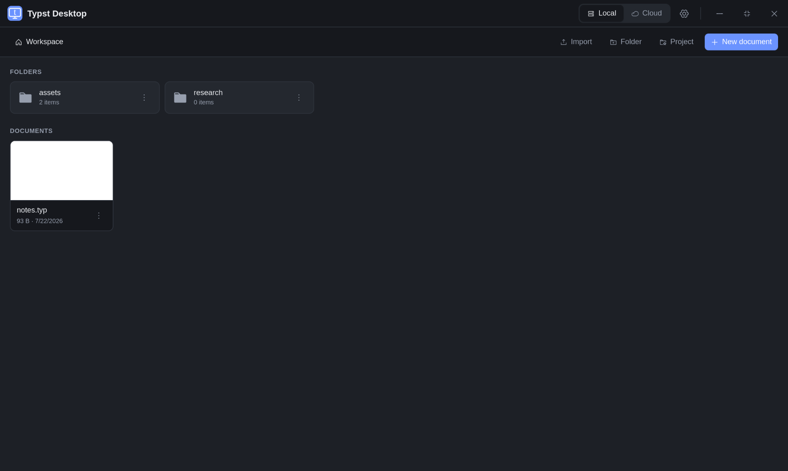
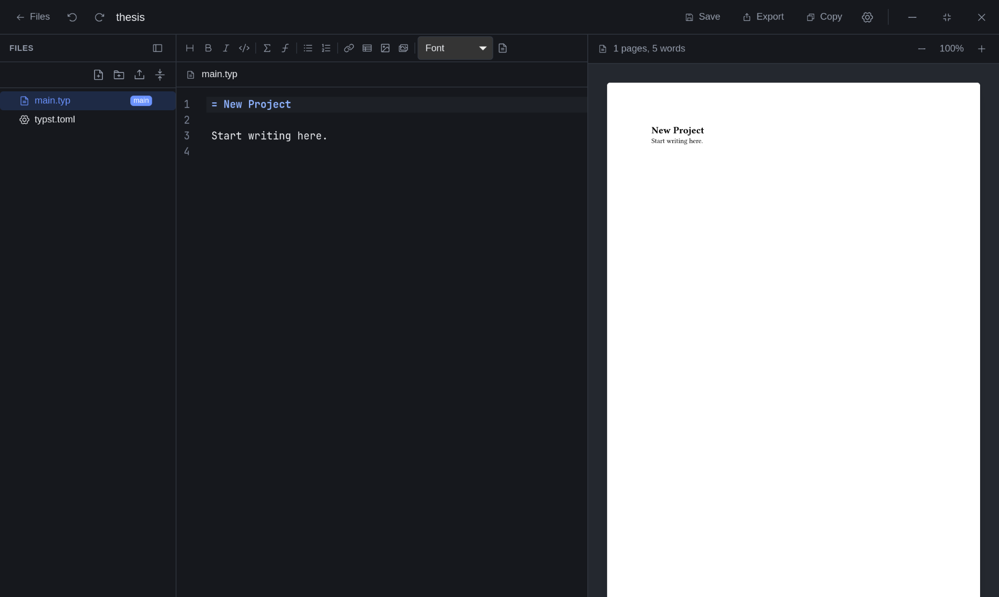
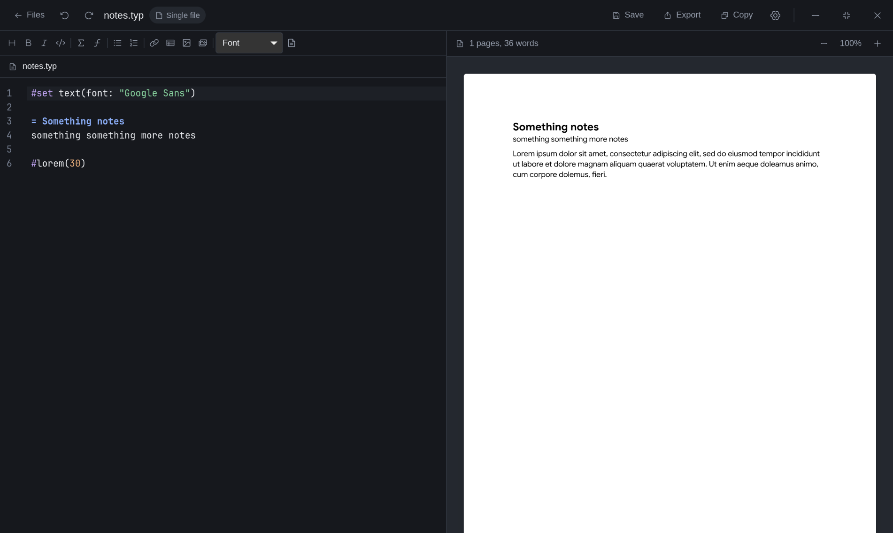

# Typst Desktop

[](https://github.com/SirBlobby/typst-desktop.git)
[](LICENSE)
[](https://typst.app/)
[](https://www.rust-lang.org/)
[](https://tauri.app/)
[](https://kit.svelte.dev/)
[](https://tailwindcss.com/)
[](https://www.sqlite.org/)

A desktop editor for Typst. Your documents stay as plain files on your own drive, and can optionally sync to a [TypstDrive](https://github.com/SirBlobby/TypstDrive.git) server so the same notes open on any device.

The Typst compiler is built into the app — there is nothing extra to install to write and export documents.

## Install

Packages are attached to each [release](https://github.com/SirBlobby/typst-desktop/releases). Set the version you want first:

```bash
VERSION=2.1.0
BASE=https://github.com/SirBlobby/typst-desktop/releases/download/v$VERSION
```

### Debian and Ubuntu

```bash
wget "$BASE/typst-desktop_${VERSION}_amd64.deb"
sudo apt install "./typst-desktop_${VERSION}_amd64.deb"
```

Installing with `apt` rather than `dpkg -i` pulls in `libwebkit2gtk-4.1-0` and `libgtk-3-0` for you. Debian 12 or Ubuntu 22.04 and newer carry a new enough WebKit.

Remove it with `sudo apt remove typst-desktop`.

### Fedora

```bash
wget "$BASE/typst-desktop-${VERSION}-1.x86_64.rpm"
sudo dnf install "./typst-desktop-${VERSION}-1.x86_64.rpm"
```

Remove it with `sudo dnf remove typst-desktop`.

### Arch

```bash
wget "$BASE/typst-desktop-${VERSION}-1-x86_64.pkg.tar.zst"
sudo pacman -U "typst-desktop-${VERSION}-1-x86_64.pkg.tar.zst"
```

Remove it with `sudo pacman -R typst-desktop`.

There is no AUR package; the `.pkg.tar.zst` above is attached to each release directly. Prefer it over the AppImage on Arch specifically — a [known WebKitGTK issue](https://bugs.webkit.org/show_bug.cgi?id=280239) on Wayland crashes the AppImage build (`Could not create default EGL display`) against Arch's current webkit2gtk version. The native package links against your system's webkit2gtk instead, which avoids it.

The AppImage runs on any distribution, so it also works as a fallback on Debian or Fedora — and on Arch too, but may hit the WebKitGTK/EGL crash described above there. Building from source is covered under [Development](#development).

## Features

- **Local first**: Every document is an ordinary file in a folder you choose. Nothing is locked in a database, and any other editor can open the same files.
- **Two views**: A file viewer for browsing local and cloud files, and an editor view for writing.
- **Single files or projects**: Open a lone `.typ` or `.tex` file, or a project folder with its own `typst.toml`, chapters, bibliography, and assets.
- **LaTeX**: Create LaTeX documents and projects by picking the language when you create them. LaTeX is converted to Typst with [MiTeX](https://github.com/mitex-rs/mitex), so basic documents, sections, lists, tables, figures and math work, while packages, `\input` and bibliographies do not. `.tex` files get a LaTeX editor, toolbar and keyboard shortcuts, and sync with TypstDrive LaTeX documents.
- **Live preview**: The preview recompiles as you type, and follows whichever file you are editing rather than only the entrypoint. Saving is not required to see changes. The **View** menu shows the editor and preview, the editor only, or the preview only.
- **Editor**: Syntax highlighting for Typst, LaTeX, BibTeX, YAML and TOML, snippet autocompletion, a formatting toolbar with heading sizes and quotes, page settings, inline diagnostics, and optional `tinymist` language server support.
- **Editor tools**: Find and search and replace, `Ctrl+/` to comment out lines, and quick insert for images, tables, project files, symbols and emoji.
- **Editor settings**: Font, font size, spell checking, line numbers and a minimap with three sizes.
- **Review**: For cloud documents open live, see who else is editing with their profile pictures, comment on text, reply and resolve threads, suggest edits that others accept or reject, save versions and browse, compare and restore version history.
- **Export**: PDF, PNG, SVG, HTML and the source file, plus Word, LaTeX, Markdown and HTML through `pandoc`. LaTeX files are read as LaTeX by `pandoc`. Word, LaTeX, Markdown and HTML files can also be converted into Typst documents.
- **Team spaces**: Browse and work in the TypstDrive team spaces you belong to from the sidebar.
- **Viewer**: Open PDFs and images from the file browser, the project file tree, or TypstDrive.
- **Local folders**: Add shortcuts to folders anywhere on your computer to browse and edit them alongside the workspace, and give folders colors.
- **File explorer**: Folder selection, a right-click menu, drag and drop, rename, duplicate, move, reveal in your file manager, search, sorting by name, date or size, and grid or list views.
- **Cloud workspace**: Browse your TypstDrive folders, documents, projects, and everything shared with you in a layout that matches the TypstDrive web drive, with search, sorting and grid or list view. Download what you want on this device and open it straight from the cloud view.
- **Sync**: Three-way merge with a conflict resolver, plus optional automatic sync on a timer.
- **Autosave**: Off by default, or every 5, 10, or 15 seconds.
- **Citations**: Paste a DOI, arXiv, PubMed, PMC or Semantic Scholar ID to add a BibTeX or Hayagriva entry to a bibliography file, and sync Zotero libraries and collections into `.bib` or `.yml` files.
- **Images and fonts**: Import from anywhere on disk, drag and drop, or pull from your TypstDrive assets. A searchable asset browser with previews sits in the editor toolbar.
- **Thumbnails**: Documents and projects show their first compiled page; images show a preview.
- **Image viewer**: Open images full screen with zoom and folder navigation.

## Storage

By default the workspace lives at `~/typst` (for example, `/home/blob/typst`). Change it in Settings.

Inside the workspace:

| Path | Contents |
|---|---|
| `<workspace>/` | Your folders, projects, and documents. |
| `<workspace>/.assets/` | Shared images and fonts available to every project. |
| `<project>/.typst-desktop.json` | Marks a folder as a project when it has no `typst.toml`, such as a LaTeX project. |

Application data — settings, sync state, and the thumbnail cache — is kept in a SQLite database in the platform's app-data directory. Documents themselves are never stored there.

## Settings

| Section | Contents |
|---|---|
| Files | Workspace folder and autosave delay. |
| Appearance | Light, dark or system mode, color theme and accent color. |
| Editor | Font, font size, spell checking, line numbers, minimap and minimap size. |
| Accessibility | Text size, reduced motion and high contrast. |
| Account | TypstDrive server, sign in and out, automatic sync interval. |
| Citations | Connect or disconnect Zotero with an API key. |
| Language Server | The `tinymist` language server. |
| Hotkeys | View and change keyboard shortcuts. |
| About | Version, Typst version, license, and links to the official Typst site. |

## Fonts and Images

Fonts and images work the same way as in TypstDrive. A file is available to the compiler by its name.

### Fonts

Import `.ttf`, `.otf`, `.ttc`, or `.otc` files through **Assets**, or place them in a folder beside your document. Typst Desktop reads the family name embedded in the file and registers every weight and style under it.

```typst
#set text(font: "JetBrains Mono")
```

The toolbar's font dropdown lists every family available to the open document, including the fonts bundled with the app. If a family is not listed, it has not been picked up, and the name in your document will not resolve.

### Images

Reference an image by its file name:

```typst
#image("logo.png", width: 50%)
```

Images in the shared asset library are available to every project. Images inside a project folder are available to that project and override an asset of the same name.

## Citations

Open **Citations** from the Insert group of the editor toolbar.

- **Add reference**: Paste a DOI, arXiv ID, PubMed ID (PMID), PMC ID or Semantic Scholar paper ID, or a link to any of them, pick a bibliography file or name a new one, then **Look up** and **Add to** the file. Files ending in `.bib` get BibTeX entries and `.yml` or `.yaml` files get Hayagriva entries. **Insert citation** puts `@key`, or `\cite{key}` in a LaTeX file, at the cursor.
- **Zotero**: Connect Zotero once in **Settings → Citations** with a read-only API key from zotero.org. The key is stored on this computer. In the **Zotero** tab, pick a library, an optional collection and a file, then **Sync to** it. The refresh button updates the file later. Syncing replaces the whole file, so keep your own entries in a separate one.

Bibliography files are ordinary files in the project or next to a single document, so they sync to TypstDrive like any other file. Lookups contact doi.org, with api.crossref.org as a fallback, api.ncbi.nlm.nih.gov for PubMed and PMC, and api.semanticscholar.org. Zotero sync contacts api.zotero.org.

## Cloud Workspace

Cloud features are optional. Without an account the app is entirely local.

1. Open **Settings**, go to **Account**, enter your TypstDrive server URL, and click **Open sign-in page**. Sign in to TypstDrive in your browser, copy the one-time key it shows, paste it into the app and click **Connect**.
2. Switch the file viewer to **Cloud**.

The cloud view has two places to look. **Home** shows your folders, documents, projects, and uploaded images and fonts. **Shared with me** shows everything other people have shared with you, along with the role you were given.

| Item | Action |
|---|---|
| Document | Download to this device, then Open to edit it. |
| Space | Download as a local project, then Open. |
| Image or font | Download into your shared asset library. |

Cards show whether an item is on this device and whether it has local changes waiting to go up. Downloaded documents are managed from the cloud view rather than appearing a second time under Local.

To publish a local project, choose **Upload to cloud** on it in the Local view. That creates a Space from its contents.

Deleting a cloud item from the app moves it to the TypstDrive trash, where it can be restored from the web drive until the server removes it for good.

### Sync

Cloud files sync in two ways:

- **Live**: When you open a cloud document or project file while online, the editor joins the same live session as the web editor. Changes appear on both sides as you type and are saved to your drive in the background.
- **Background**: When a live session is not available, the app syncs the whole document or project. It syncs when you open it, a few seconds after each save, whenever the server reports a change, and on the timer set in **Settings**. Sync pulls before it pushes.

Use **Sync** in the editor to run a sync by hand.

Viewer access is read-only: a document shared with the viewer role can be downloaded and read, but pushing changes back is refused.

### Comments, suggestions and history

When a cloud document is open with live collaboration, the bar above the editor shows who is editing, the **Editing** or **Suggesting** mode, and buttons for comments, saving a version and version history.

- Select text and press `Ctrl+Alt+M`, or use the comment button, to comment on it. Hover over highlighted text to preview a comment, and click it to open the thread, reply or resolve it.
- In **Suggesting** mode your edits become suggestions. Owners and editors accept or reject them from the **Suggestions** tab. People shared a document with the suggester role are always in suggesting mode.
- **Version history** lists every version with who edited and when. Compare a version with the one before it or with the current document, name it, or restore it.

These features need a TypstDrive server that supports them. Versions are also saved automatically when you leave a document after editing it.

### Conflicts

When a file changed both locally and in the cloud, a three-way merge is attempted against the version last synced. If the merge cannot be resolved automatically, a conflict resolver opens where you can keep either version or edit the merged result. Binary files cannot be merged and keep the cloud version. Automatic sync pauses while conflicts are unresolved.

## Language Server

Typst Desktop can use [`tinymist`](https://github.com/Myriad-Dreamin/tinymist) for hover documentation, go-to-definition, and richer diagnostics. It is not bundled — install it and make sure it is on your `PATH`:

```bash
curl -L -o ~/.cargo/bin/tinymist \
  https://github.com/Myriad-Dreamin/tinymist/releases/latest/download/tinymist-linux-x64 \
  && chmod +x ~/.cargo/bin/tinymist
```

The editor header shows the language server status. Without `tinymist` the editor still has syntax highlighting, autocompletion, and compiler diagnostics.

## Pandoc

Exporting to Word, LaTeX, Markdown and HTML, and converting those formats into Typst, uses [`pandoc`](https://pandoc.org), which ships with the app. Pandoc is licensed under the GPL, version 2 or later, and its license is installed alongside the app.

When building from source, `bun run tauri dev` and `bun run tauri build` download the pinned pandoc release for your platform into `src-tauri/binaries/` first. To fetch it on its own, for example before running `cargo` directly:

```bash
bun run fetch:pandoc
```

The pandoc version is set by `PANDOC_VERSION` in `scripts/fetch-pandoc.mjs`.

## Development

The app compiles Typst from source, so clone the compiler into this repo's `typst/` folder and check out the pinned commit first:

```bash
git clone https://github.com/typst/typst.git typst
git -C typst checkout bd5ebec285505889e8ff1d4f68804ab147a699f3
```

If `typst/` already exists, update it to the pinned commit instead:

```bash
git -C typst fetch
git -C typst checkout bd5ebec285505889e8ff1d4f68804ab147a699f3
```

Then:

```bash
bun install
bun run tauri dev
```

To build a release bundle for your own platform:

```bash
bun run tauri build
```

On Linux, use `bun run build:linux` instead. It is the same command with `NO_STRIP=1` set, which the AppImage bundler needs on a rolling-release distribution. See [Platform notes](#platform-notes).

### Platform notes

`.msi` packages can only be built on Windows, because the WiX Toolset is Windows-only. Building on the target platform is the supported path for both Windows and macOS.

The Windows installers download the WebView2 bootstrapper when the runtime is missing. Windows 10 (April 2018 or later) and Windows 11 already ship it, so this only affects older systems. The NSIS installer asks whether to install for the current user or the whole machine.

macOS builds are unsigned. Gatekeeper blocks unsigned apps on first launch, so open the app once with right-click then **Open**, or run `xattr -dr com.apple.quarantine "/Applications/Typst Desktop.app"` after installing.

### Building locally for another platform

Building on the target platform is the supported path. The Typst compiler is a path dependency, so any machine or runner needs it checked out inside this repository:

```bash
git clone https://github.com/typst/typst.git typst
git -C typst checkout bd5ebec285505889e8ff1d4f68804ab147a699f3
```

Linux builds also need the WebKit and GTK development packages:

```bash
sudo apt-get install libwebkit2gtk-4.1-dev libgtk-3-dev librsvg2-dev patchelf
```

```bash
bun run build:linux
```

Build on Ubuntu 22.04 (the CI baseline) rather than a rolling-release distro. glibc compatibility only works forward, so a binary is only guaranteed to run on distros with a glibc version equal to or newer than the one it was built against. This won't cover musl-based distros like Alpine, or glibc-based distros older than the build machine.

On Arch, `packaging/arch/PKGBUILD` builds and installs a native package via `makepkg -si` from within `packaging/arch/`, instead of `bun run build:linux`.

## License

Apache License 2.0. See [LICENSE](LICENSE).

Typst Desktop is a community application and is not affiliated with, endorsed by, or supported by the official Typst project. Links to Typst documentation and Typst Universe open the official Typst website in your browser.






